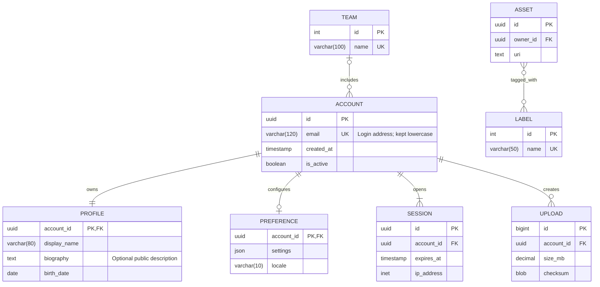
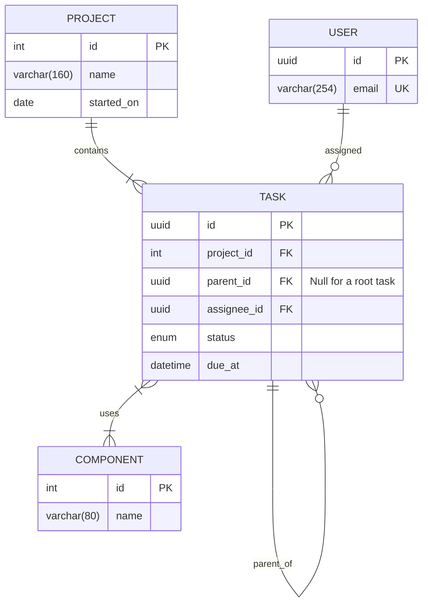

# Entity relationship diagrams

The first example intentionally covers the full set of Mermaid ER endpoint
markers on six relationship lines: exactly one (`||`), zero-or-one (`o|`),
one-or-more (`|{`), and zero-or-more (`o{`). It also includes composite keys,
foreign keys, several data types, and an attribute comment.

The second example adds mandatory many-to-many links, a self-reference, and
named attributes with notes:

