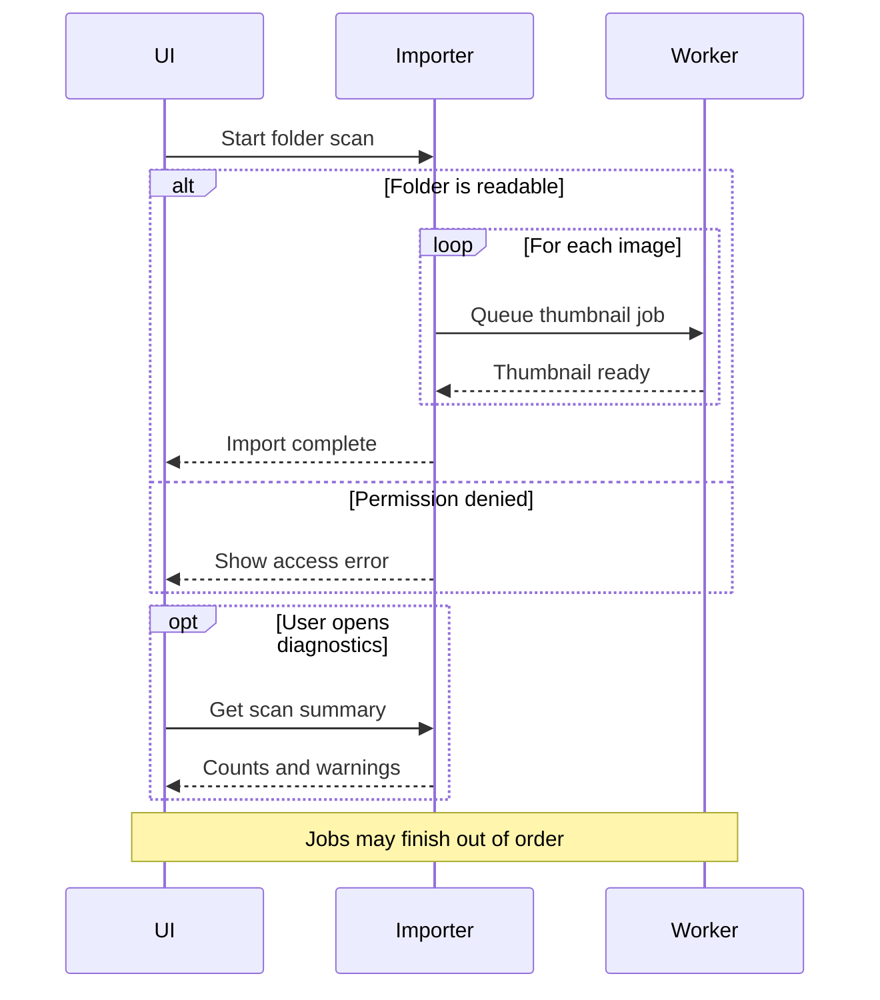

# Sequence diagrams

```mermaid
sequenceDiagram
  actor User
  participant UI as Desktop UI
  participant API as Catalog API
  database DB as Catalog DB
  User->>UI: Search for a texture
  activate UI
  UI->>+API: GET /assets?q=wood
  API->>+DB: Query indexed metadata
  DB-->>-API: Matching asset rows
  API-->>-UI: Results and thumbnails
  UI-->>User: Display result grid
  deactivate UI
```

Alternatives, optional work, loops, notes, and asynchronous messages:


